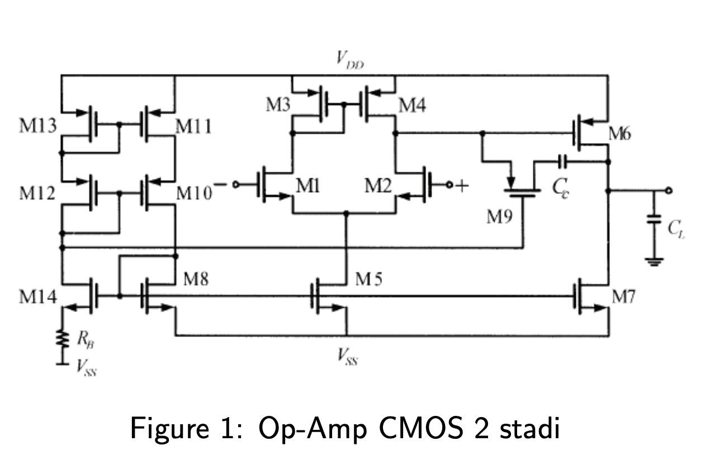
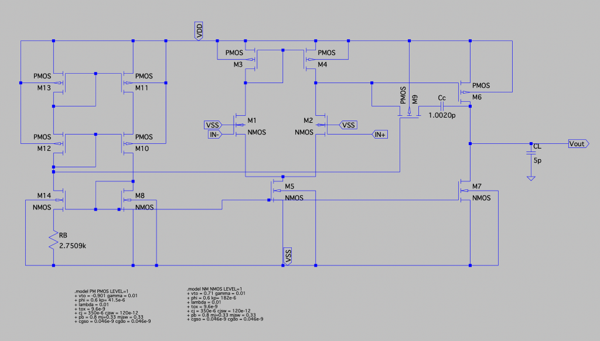
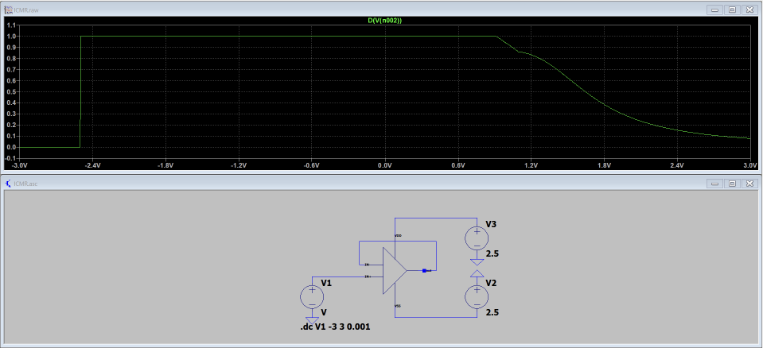
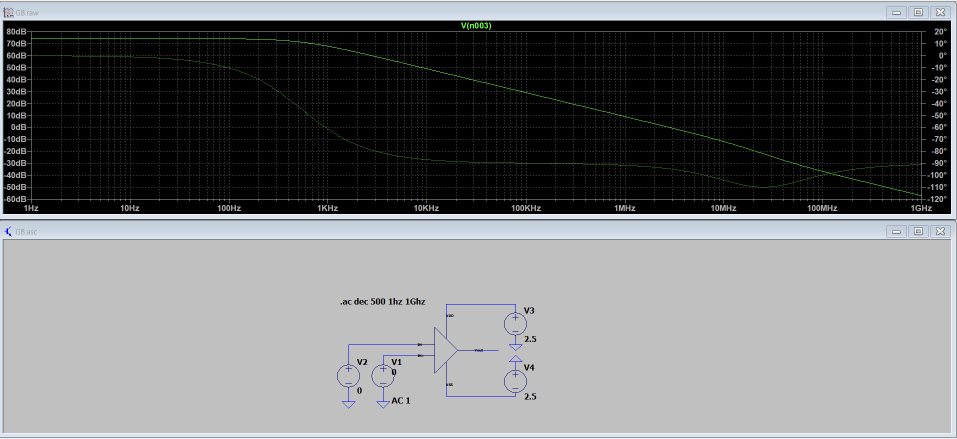
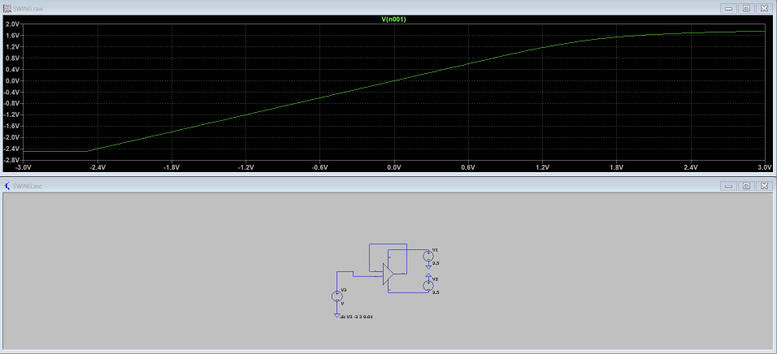
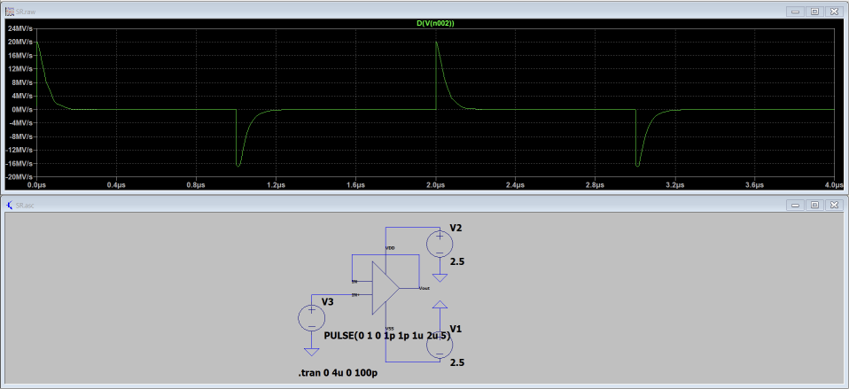

<h1 align="center">CMOS Two-Stage Op-Amp</h1>

  <b>A Miller-compensated two-stage CMOS operational amplifier, sized by hand from a spec sheet and verified in LTspice.</b> 
  University of Bologna · Analog Circuits and Sensor Systems

  
  
  
  

  

## What this is

The op-amp is the building block behind almost every analog circuit: filters, sensor front-ends, ADC drivers. This project designs one from scratch: start from a list of required numbers, work out the width of every transistor with the square-law equations, then build it in LTspice and check that the real circuit behaves as designed.

The circuit has two parts:

1. **Biasing network** (M8, M10 to M14 and a resistor RB) that produces the reference currents.
2. **Two-stage amplifier**: an NMOS differential pair (M1, M2) with a PMOS current-mirror load (M3, M4) for gain, followed by a common-source stage (M6, M7) for more gain and output swing. A Miller capacitor Cc with a nulling transistor M9 (in triode) keeps the loop stable.

## Target specification

| Parameter | Target |
|---|---|
| Supply VDD / VSS | +2.5 V / −2.5 V |
| Slew rate | ±5 V/µs |
| Load capacitance CL | 5 pF |
| Input common-mode range | −1.3 V to +2.1 V |
| Output swing | −2.2 V to +2.2 V |
| Gain-bandwidth | 5 MHz |
| Differential gain | > 80 dB |
| Phase margin | > 60° |

Process: level-1 MOSFET models (NMOS VT = 0.71 V, k′ = 182 µA/V²; PMOS VT = −0.901 V, k′ = 41.5 µA/V²; tox = 9.6 nm, λ = 0.01).

## How it was designed

An 11-step hand calculation, each step feeding the next:

| Step | What is computed | Result |
|---|---|---|
| 1 | Compensation capacitor from the noise, GBW and slew-rate targets | Cc = 1.002 pF, Vov3 = 0.209 V |
| 2 | Second-stage current | I6 = I7 = 31.0 µA |
| 3 | Channel length from M6 (used for every transistor) | L = 4.30 µm |
| 4 | Size of M6 | W/L = 16.6, W = 71.4 µm |
| 5 | Tail current from the slew rate | I5 = 6.0 µA |
| 6 to 11 | Input pair, tail, mirror load, output sink and nulling transistor, with perfect current balancing | table below |

Final widths (all L = 4.30 µm):

| M1 | M2 | M3 | M4 | M5 | M6 | M7 | M8 | M9 | M10 to M13 | M14 |
|---|---|---|---|---|---|---|---|---|---|---|
| 5.60 µm | 5.60 µm | 6.92 µm | 6.92 µm | 2.60 µm | 71.4 µm | 13.4 µm | 2.60 µm | 13.8 µm | 13.8 µm | 10.4 µm |

The bias resistor came out at RB = 2.75 kΩ.

## Simulation in LTspice

The amplifier was wrapped as a subcircuit and tested with four analyses.

  

| Input common-mode range (DC sweep) | Gain and bandwidth (AC sweep, 1 Hz to 1 GHz) |
|---|---|
|  |  |
| **Output swing (DC sweep)** | **Slew rate (transient, 1 µs pulses)** |
|  |  |

## What's in this repo

| File | What it is |
|---|---|
| [`Two-Stage-OpAmp-Report.pdf`](Two-Stage-OpAmp-Report.pdf) | The full report: specification, all 11 design steps with equations, LTspice schematics and simulation plots |
| [`docs/`](docs) | The figures used on this page, taken from the report |

## Skills shown

Analog IC design · CMOS square-law sizing · Miller compensation and phase margin · current mirrors and biasing · LTspice (DC, AC and transient analysis)

## Related

[CMOS Low-Voltage Op-Amp](https://github.com/theommishra-dev/cmos-low-voltage-opamp): the follow-up project, a folded-cascode op-amp that runs from a single 2 V supply.

---

Om Mishra · MSc Electronic Engineering, University of Bologna. This repository holds the project report.
